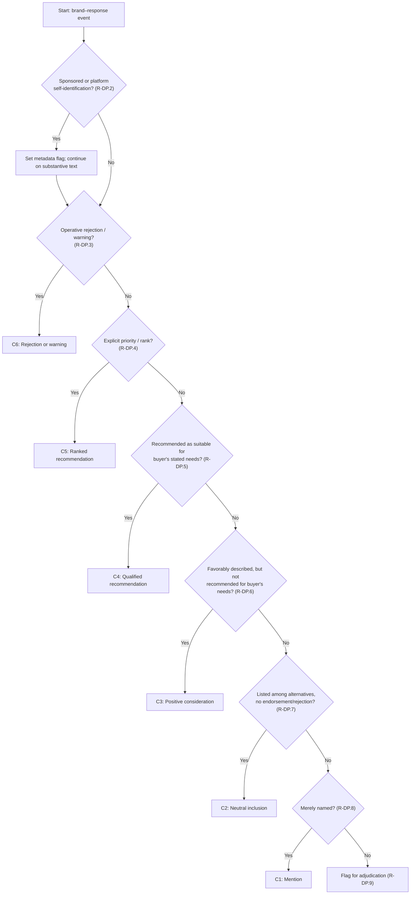

# AI Recommendation Share — Public Coding Protocol v1.1

---

## D1. Front Matter and Scope

| Field | Value |
|---|---|
| Document title | AI Recommendation Share — Public Coding Protocol |
| Version | 1.1.0 |
| Status | Active — frozen for measurement |
| Intended users | Human coders, LLM-coder operators, adjudicators, and principal investigators conducting AI Recommendation Share (ARS) measurement |
| Unit of analysis | The **brand–response event**: one brand × one AI response. A single response that names *n* distinct brands yields up to *n* brand–response events. |
| Normative dependencies | This protocol operationalizes the ARS construct and the C1–C6 taxonomy defined by the project owner. Those definitions are normative and are not redefined here. |

### 1.1 In scope

- Classification of every brand appearance in an AI-generated response to a standardized buyer-intent question, into exactly one of C1–C6.
- Capture of subtype, recommendation strength, final-choice status, rank position, evidence span, and platform/sponsorship metadata for each event.
- Procedures for double/triple coding, adjudication, reliability estimation, LLM-assisted coding, and coder onboarding.

### 1.2 Out of scope

- Sentiment scoring, emotion detection, or rhetorical analysis beyond the six-class taxonomy.
- Estimation of market share, platform quality, or longitudinal trends.
- Sampling design, question authoring, and data collection (governed by separate instruments).
- Any normative redefinition of ARS, Recommendation Incidence, or Final Choice Incidence.

### 1.3 Core principle (conservative default)

Where a classification judgment is genuinely ambiguous and cannot be resolved by a cited rule, the coder applies the **conservative default**: the interpretation that never inflates a recommendation. In practice this means preferring C3 over C4, C4 over C5, and C6 over any positive code when the operative stance is rejection. Every such default is recorded in the [Known Ambiguities appendix](#appendix-b-known-ambiguities) and surfaced for owner review.

---

## D2. Decision Procedure

Every coder applies the following ordered procedure to each brand–response event. The procedure is a strict cascade: the **first** node whose test is satisfied determines the code. Tests are answerable from the verbatim response text together with the Market Question Cell (the buyer-intent question and its stated requirements). No external knowledge of the brand may inform the code.

### 2.1 Rule set

- **R-DP.1 (Brand detection and de-duplication).** A brand appearance is any naming of a brand in the response, including in prose, lists, tables, URLs, code blocks, and quoted text. Resolve aliases and acronyms to a canonical brand name (e.g., "SFDC" → Salesforce; "GH Copilot" → GitHub Copilot). Multiple mentions of the same brand within one response collapse to a single brand–response event.
- **R-DP.2 (Sponsored and self-identification handling).** If the appearance occurs inside a disclosed sponsored block, or is a platform self-identification, set the corresponding metadata flag (`sponsored` or `platform_self_id`) to `true`. Classification then proceeds on the substantive text in the response's own voice. The flag must not influence the class assignment.
- **R-DP.3 (Operative rejection test).** Is the brand explicitly discouraged, warned against, or identified as unsuitable for the buyer's stated needs, such that this is the operative conclusion about the brand? If yes → **C6**. **Determinism of "operative":** the operative stance is the stance expressed in the response's conclusive or final evaluative statement about the brand — identified by a conclusion marker ("so", "overall", "in short", "ultimately", "bottom line") or, absent a marker, the last evaluative clause about the brand. If praise and rejection are genuinely concurrent with no conclusive marker, do not default; flag the event for adjudication per R-DP.9.
- **R-DP.4 (Ranked recommendation test).** Does the response assign the brand an explicit priority or rank ("top pick", "best fit", "#1", "first choice", "I'd start with", ordered numerical preference with ranking intent)? If yes → **C5**.
- **R-DP.5 (Qualified recommendation test).** Does the response communicate — explicitly or implicitly — that the brand is a suitable option for the buyer's stated requirements (the Market Question Cell scenario), with enough context to support the classification? If yes → **C4**.
- **R-DP.6 (Positive consideration test).** Does the brand receive favorable description (praise, strengths) that does not rise to a recommendation for the buyer's stated needs? If yes → **C3**.
- **R-DP.7 (Neutral inclusion test).** Does the brand appear among alternatives with only factual attributes (including factual shortcomings) and no endorsement or explicit discouragement? If yes → **C2**.
- **R-DP.8 (Mention test).** Is the brand merely named, with no descriptive, evaluative, or comparative content? If yes → **C1**.
- **R-DP.9 (Adjudication fallback).** If no node from R-DP.3 through R-DP.8 is satisfied, the coder must not default; the event is flagged for adjudication with the candidate codes considered.

### 2.2 Cascade order and rationale

The cascade order is C6 → C5 → C4 → C3 → C2 → C1, applied through R-DP.3 to R-DP.8. This order encodes the **operative-stance principle**: when a brand receives mixed signals (e.g., praised and then rejected, or ranked and then discouraged), the most informative single code is the operative conclusion about whether the buyer should use the brand. C6 precedes C5 because explicit discouragement overrides a ranking; C5 precedes C4 because a rank is a stronger form of recommendation; and so on down to C1. The order is also the conservative order with respect to ARS inflation: it never assigns a recommendation code (C4/C5) when a non-recommendation code (C1/C2/C3/C6) is operative.

### 2.3 Flowchart



---

## D3. Classification Rules

For each class: full definition, inclusion criteria, exclusion criteria, boundary rules, and treatment of multi-brand responses, comparison tables, and rankings.

### 3.1 C1 — Mention

**Definition.** The brand is named only, with no descriptive, evaluative, or comparative content beyond identification.

**Inclusion.** R-C1.1: The brand name appears with no accompanying descriptor, comparison, or judgment.

**Exclusion.** R-C1.2: Any evaluative adjective, comparison, or positioning statement moves the brand out of C1 to the appropriate higher node.

**Boundary rules.**
- R-C1.3: A brand appearing only in a URL, citation, footnote, or code identifier, with no surrounding commentary, is C1.
- R-C1.4: A brand named in passing within a sentence primarily about a different brand is C1 for the passing brand (and classified independently for the primary brand).
- R-C1.5: A brand named only inside a sponsored/promotional block, where the response itself does not substantively endorse it, is C1 with `sponsored = true`.

**Multi-brand / tables / rankings.** Each brand is evaluated independently. A brand appearing only as a column header or row label in a factual table with no descriptor is C1.

### 3.2 C2 — Neutral inclusion

**Definition.** The brand appears among alternatives without endorsement or rejection.

**Inclusion.** R-C2.1: The brand is listed, tabulated, or grouped with one or more alternatives, and the accompanying content is factual rather than evaluative.

**Exclusion.** R-C2.2: Evaluative praise moves the brand to C3; explicit discouragement moves it to C6. A factual shortcoming stated without evaluative judgment or discouragement does not by itself move the brand out of C2.

**Boundary rules.**
- R-C2.3: "Options include A, B, and C" with no further commentary → C2 for all.
- R-C2.4: A comparison table reporting only factual attributes (price, feature presence, free-tier availability) with no evaluative conclusion → C2 for every listed brand.
- R-C2.5: "A and B are both CRM tools" → C2 for both.

**Multi-brand / tables / rankings.** In a neutral list or factual table, every brand is C2 unless a prose conclusion elevates or demotes a specific brand. A numbered list without ranking language (per R-C5.2) is treated as a neutral list and classified by substance.

### 3.3 C3 — Positive consideration

**Definition.** The brand receives favorable description but is not recommended for the buyer's stated needs.

**Inclusion.** R-C3.1: The response attributes strengths, praise, or favorable qualities to the brand, but does not communicate that the brand is a suitable option for the buyer's stated requirements.

**Exclusion.** R-C3.2: If the favorable description culminates in a recommendation for the buyer's stated needs → C4 (or C5 if ranked). R-C3.3: If the operative stance is rejection despite present praise → C6 (per cascade).

**Boundary rules.**
- R-C3.4: "A is a solid tool with good UX" with no recommendation language → C3.
- R-C3.5: A brand receiving mixed praise and shortcomings, where praise is present, no recommendation is made, and no explicit discouragement is operative → C3.
- R-C3.6: Backhanded or conditional praise that does not tie to the buyer's stated needs (e.g., "A is great if you need X" where X is not a stated need) → C3.
- R-C3.7 (generic praise on a list): Generic favorable description applied to a list ("all are good", "these are all solid", "both are quality tools") moves each listed brand from C2 to C3, provided no individualized recommendation is made.

**Multi-brand / tables / rankings.** In a table with prose praise for some brands but no recommendation, the praised brands are C3 and the unpraised brands are C2. A brand praised generically ("all are good") without individualized recommendation is C3.

### 3.4 C4 — Qualified recommendation

**Definition.** The brand is recommended as suitable for the buyer's stated requirements (explicit or implicit), with enough context to support the classification.

**Inclusion.** R-C4.1: The response communicates that the brand is a suitable option for the buyer's stated needs, satisfying all three qualified-recommendation conditions: (a) suitability is communicated, not merely named or described; (b) the recommendation relates to the Market Question Cell scenario; (c) sufficient context is present.

**Subtypes.**
- R-C4.2 (explicit): The response contains an explicit recommendation marker. The marker inventory is: "recommend(s/ed)", "I'd go with", "I'd pick/choose", "you should use/pick/choose", "the right choice is", "my advice is", "I suggest", "opt for", "go with X". The presence of any marker from this inventory, applied to the buyer's stated needs, makes the subtype explicit.
- R-C4.3 (implicit): The response reaches a comparative or eliminative conclusion favoring the brand for the buyer's stated needs without any explicit marker from the R-C4.2 inventory. The implicit-marker inventory is: "the better fit", "the natural fit/choice", "stands out for", "is the stronger option for", "makes the most sense for", "fits your needs". A superlative or comparative conclusion tied to the buyer's stated needs, with no explicit verb, is implicit.

**Exclusion.** R-C4.4: If a rank is also assigned → C5. R-C4.5: If the recommendation does not relate to the buyer's stated needs → C3 (conservative).

**Boundary rules.**
- R-C4.6 (conditional, matching): "If you need X, then A" where X matches the buyer's stated need → C4 (subtype per language used).
- R-C4.7 (conditional, non-matching): "If you need X, then A" where X does not match the buyer's stated need → C3 (conservative default; flagged in Known Ambiguities).
- R-C4.8 (hedge language): Constructions such as "may be worth considering", "could be a good option", "might work" are treated as C3 unless accompanied by clear, non-hedged suitability for the buyer's stated needs, in which case C4. The conservative default is C3.
- R-C4.9 (multi-brand recommendation): Multiple brands may each be C4 if each is independently recommended as suitable. The absence of a ranking does not demote a C4 to C3.
- R-C4.10 (out-of-category recommendations): If the response recommends a brand that falls outside the question's software category for the buyer's stated need, classify by the response's stance toward the stated need, not by the brand's actual category. The protocol measures the response, not its correctness.

### 3.5 C5 — Ranked recommendation

**Definition.** The brand receives an explicit priority or rank.

**Inclusion.** R-C5.1: The response assigns the brand an explicit priority or rank using ranking language ("best fit", "top pick", "#1", "first choice", "I'd start with", "my preferred", or an ordered preference with ranking intent).

**Exclusion.** R-C5.2: A mere numbered or bulleted list without ranking language is not C5; it is classified by substance (typically C2 or C3).

**Boundary rules.**
- R-C5.3: "My top pick is A" → C5, `rank_position = 1`.
- R-C5.4: "A is my second choice" → C5, `rank_position = 2`.
- R-C5.5 (category winners): "Best for budget: A; Best for marketing: B" → C5, `rank_position = 1` for each brand within its named category, **but only when the category label matches one of the buyer's stated needs**. If the category label does not match any stated need, the brand is downgraded to C3 (favorable description). If the response also names an overall winner whose scope matches the buyer's needs, that brand's overall rank governs `final_choice`.
- R-C5.6 (ranked list with a single overall winner): The overall winner is C5 rank 1; the other ranked brands are C5 at their stated rank. Brands in the list that are not ranked are classified by substance.
- R-C5.7 (strength within C5): rank 1 > rank 2 > rank n. `rank_position` is recorded as an integer ≥ 1.
- R-C5.8 (comparative is not a rank): A bare comparative ("A is better than B", "A is superior to B") without ordinal or priority language is C4 implicit, not C5. Ranking requires a priority marker from the R-C5.1 inventory.

**Multi-brand / tables / rankings.** When a response ranks several brands, each ranked brand is a separate C5 event with its own `rank_position`. Unranked brands in the same response are classified independently.

### 3.6 C6 — Rejection or warning

**Definition.** The brand is discouraged or identified as unsuitable.

**Inclusion.** R-C6.1: The response explicitly discourages the brand, warns against it, or identifies it as unsuitable for the buyer's stated needs, and this is the operative conclusion.

**Exclusion.** R-C6.2: Being surpassed by another brand, or having a factual shortcoming, without explicit discouragement, is not C6 (classify as C2 or C3 per substance).

**Boundary rules.**
- R-C6.3: "I'd avoid A for your use case" → C6.
- R-C6.4: "A is overkill / too heavy / not worth it for your needs" → C6.
- R-C6.5 (conditional rejection, matching): "If you need simplicity, avoid A" where the buyer stated simplicity as a need → C6. If the buyer did not state that need → conservative default C3 (if praise present) or C2, flagged in Known Ambiguities.
- R-C6.6 (rejection after praise): Praise followed by operative rejection ("A is polished but I can't recommend it here") → C6 per cascade.

**Multi-brand / tables / rankings.** A brand rejected in a comparison is C6 regardless of how many other brands are recommended. Rejection of a brand does not affect the classification of other brands in the same response.

---

## D4. Worked Examples

Twenty-five annotated examples. Each lists the buyer context (the Market Question Cell scenario), the verbatim or realistic synthetic excerpt, the assigned code(s), the rule(s) applied (cited by ID), and the rationale. Examples marked **[Borderline]** exercise a deliberately difficult judgment. Brand names are used in synthetic excerpts for realism; no empirical claim is made about any brand.

**E1 [Clear] — C1, mention only.**
Context: buyer asks for a CRM recommendation for a 50-person sales team.
Excerpt: *"Salesforce was founded in 1999 and pioneered the SaaS CRM model."*
Code: C1. Rules: R-C1.1, R-C1.2. Rationale: brand named with only historical/factual identification; no evaluative or comparative content.

**E2 [Clear] — C2, neutral list.**
Context: buyer asks for project management tools for a 10-person design team.
Excerpt: *"Common project management tools include Asana, Monday.com, and ClickUp."*
Codes: C2 for Asana, Monday.com, ClickUp. Rules: R-C2.1, R-C2.3. Rationale: brands listed as alternatives with no evaluative differentiation.

**E3 [Clear] — C3, positive consideration.**
Context: buyer asks for an AI coding assistant for a Python-heavy team.
Excerpt: *"GitHub Copilot is widely praised for its inline completions and broad language support."*
Code: C3. Rules: R-C3.1, R-C3.2. Rationale: favorable description but no recommendation for the buyer's Python needs.

**E4 [Clear] — C4, explicit.**
Context: buyer is a 5-person startup needing an affordable, simple CRM.
Excerpt: *"For a 5-person startup, I recommend Pipedrive for its simplicity and affordable pricing."*
Code: C4, subtype explicit, strength 2. Rules: R-C4.1, R-C4.2. Final choice: Pipedrive. Rationale: explicit recommendation tied to the buyer's stated needs.

**E5 [Clear] — C4, implicit.**
Context: buyer needs a CRM with strong marketing automation for a 20-person team.
Excerpt: *"Given your emphasis on marketing automation at your size, HubSpot's native CRM-to-marketing pipeline is the better fit."*
Code: C4, subtype implicit, strength 1. Rules: R-C4.1, R-C4.3. Final choice: HubSpot. Rationale: comparative conclusion favoring HubSpot for the buyer's stated needs; no explicit recommendation verb.

**E6 [Clear] — C5, rank 1.**
Context: buyer is a solo founder needing the cheapest CRM.
Excerpt: *"My top pick for a solo founder on a tight budget is Pipedrive."*
Code: C5, rank_position 1, strength 5. Rules: R-C5.1, R-C5.3. Final choice: Pipedrive. Rationale: explicit top-pick language tied to the buyer's stated needs.

**E7 [Clear] — C6, rejection.**
Context: buyer is a 3-person team wanting a simple CRM.
Excerpt: *"I'd avoid Salesforce for a team of three — it's overkill and the setup overhead isn't worth it."*
Code: C6. Rules: R-C6.1, R-C6.4. Rationale: explicit discouragement tied to the buyer's profile.

**E8 [Borderline] — hedge language → C3.**
Context: buyer is a 3-person startup wanting a simple, affordable CRM.
Excerpt: *"HubSpot may be worth considering if you're just getting started."*
Code: C3. Rules: R-C4.8, R-C4.5. Rationale: "may be worth considering" is hedge language; even though "just getting started" loosely matches the buyer profile, the response does not clearly communicate suitability. Conservative default C3.

**E9 [Borderline] — implicit recommendation + factual shortcoming.**
Context: buyer needs a CRM with strong marketing automation for a 20-person team.
Excerpt: *"HubSpot unifies CRM and marketing automation natively, while Pipedrive would require third-party integrations to match your automation requirements. For a 20-person marketing-driven team, HubSpot is the natural fit."*
Codes: HubSpot = C4, subtype implicit, strength 1 (R-C4.3); Pipedrive = C2 (R-C2.2, R-C6.2). Final choice: HubSpot. Rationale: HubSpot reaches a comparative conclusion for the buyer's needs (implicit C4); Pipedrive has a factual shortcoming but no explicit discouragement (C2, not C6).

**E10 [Borderline] — backhanded praise → C6.**
Context: buyer needs a scalable CRM for a fast-growing 200-person company.
Excerpt: *"HubSpot is delightful for small teams, but you'll outgrow it quickly at your growth rate."*
Code: C6. Rules: R-C6.1, R-C6.6, R-C3.5. Rationale: favorable descriptor present, but the operative conclusion is unsuitability for the buyer's stated need (scale); C6 governs per cascade.

**E11 [Borderline] — conditional recommendation matching buyer need → C4.**
Context: buyer explicitly needs real-time collaboration in a PM tool.
Excerpt: *"If real-time collaboration is your priority, then ClickUp is a strong choice."*
Code: C4, subtype explicit, strength 2. Rules: R-C4.6, R-C4.1. Rationale: the condition matches the buyer's stated need; the conditional recommendation qualifies as C4.

**E12 [Borderline] — conditional recommendation NOT matching buyer need → C3.**
Context: buyer needs enterprise-grade security and compliance (stated need); collaboration is not stated.
Excerpt: *"If real-time collaboration is your priority, then ClickUp is a strong choice."*
Code: C3. Rules: R-C4.7, R-C4.5. Rationale: the condition does not match the buyer's stated need; the recommendation does not relate to the Market Question Cell scenario; conservative default C3.

**E13 [Borderline] — ranked list without stated preference → C2.**
Context: buyer asks for PM tools for a hybrid team.
Excerpt: *"1. Asana  2. Monday.com  3. ClickUp  — these are all widely used."*
Codes: C2 for all three. Rules: R-C5.2, R-C2.1, R-C2.3. Rationale: mere numbered listing without ranking language; classify by substance (neutral list). Not C5.

**E14 [Borderline] — platform self-identification.**
Context: buyer asks for an AI coding assistant; response generated by Claude.
Excerpt: *"I should note that I'm Claude, made by Anthropic. For AI coding assistance, Claude offers strong reasoning for complex refactors, while GitHub Copilot excels at fast inline completions."*
Codes: Claude = C3, `platform_self_id = true` (R-DP.2, R-C3.1); GitHub Copilot = C3 (R-C3.1). Rationale: self-identification recorded as metadata; classification based on substantive text. Both brands receive favorable description but no recommendation for the buyer's specific needs → C3.

**E15 [Borderline] — sponsored placement.**
Context: buyer asks for a CRM; response contains a disclosed sponsored block.
Excerpt: *"[Sponsored] Pipedrive — Start your free trial today. [End sponsored] For your needs, I'd actually recommend HubSpot for its marketing automation."*
Codes: Pipedrive = C1, `sponsored = true` (R-DP.2, R-C1.5); HubSpot = C4, subtype explicit, strength 2 (R-C4.2). Final choice: HubSpot. Rationale: the sponsored block is promotional copy, not a recommendation in the response's own voice; Pipedrive is merely named by the response → C1. Sponsored flag recorded as metadata.

**E16 [Borderline] — comparison table, factual only → C2.**
Context: buyer asks for a CRM comparison.
Excerpt: *"| Tool | Price | Free tier | | HubSpot | $$ | Yes | | Pipedrive | $ | No | | Salesforce | $$$ | No |"*
Codes: C2 for all three. Rules: R-C2.1, R-C2.4. Rationale: factual comparison table with no evaluative conclusion; all brands C2.

**E17 [Borderline] — comparison table with evaluative conclusion → C4 + C2.**
Context: buyer needs an affordable CRM with a free tier.
Excerpt: *"| Tool | Price | Free tier | | HubSpot | $$ | Yes | | Pipedrive | $ | No |  Given your need for a free tier, HubSpot is the right choice."*
Codes: HubSpot = C4, subtype explicit, strength 2 (R-C4.2); Pipedrive = C2 (R-C2.4). Final choice: HubSpot. Rationale: the table is factual, but the prose conclusion recommends HubSpot for the buyer's stated need.

**E18 [Borderline] — "A is good but B is better" → C3 + C4.**
Context: buyer needs a PM tool for a software development team.
Excerpt: *"Asana is a solid general-purpose tool, but for a development team, Jira is the better fit."*
Codes: Asana = C3 (R-C3.1); Jira = C4, subtype implicit, strength 1 (R-C4.3). Final choice: Jira. Rationale: Asana praised but not recommended for the buyer's specific need; Jira reaches a comparative conclusion for the buyer's scenario.

**E19 [Borderline] — multiple conditional recommendations, no winner.**
Context: buyer needs both simplicity AND advanced reporting (two stated needs).
Excerpt: *"If simplicity is the priority, go with Trello. If advanced reporting matters more, Asana is the better choice."*
Codes: Trello = C4, subtype explicit, strength 2 (R-C4.6); Asana = C4, subtype explicit, strength 2 (R-C4.6). Final choice: null for both (R-FC.4). Rationale: both conditional recommendations match stated needs; no ranking between them; no single winner.

**E20 [Borderline] — rejection after praise → C6.**
Context: buyer needs an enterprise CRM with strict compliance.
Excerpt: *"HubSpot has a beautiful interface and great marketing features, but I can't recommend it for enterprise compliance requirements."*
Code: C6. Rules: R-C6.1, R-C6.6, R-C3.5. Rationale: operative stance is rejection for the buyer's stated need; praise is present but non-operative; C6 governs per cascade.

**E21 [Borderline] — hedge "could work" → C3.**
Context: buyer needs a PM tool for a small creative team.
Excerpt: *"Trello could work for a small creative team, though it lacks advanced reporting."*
Code: C3. Rules: R-C4.8, R-C3.1. Rationale: "could work" is hedge language; the appended shortcoming prevents clear suitability; conservative C3.

**E22 [Borderline] — ranked recommendation with multiple categories.**
Context: buyer needs a CRM balancing budget and marketing automation.
Excerpt: *"Best for budget: Pipedrive. Best for marketing automation: HubSpot. Best overall for your mixed needs: HubSpot."*
Codes: Pipedrive = C5, rank_position 1 (category: budget), strength 3 (R-C5.5, R-F.7 — category winner, not overall); HubSpot = C5, rank_position 1 (overall), strength 5 (R-C5.5, R-F.4). Final choice: HubSpot (overall winner). Rationale: Pipedrive is a category winner matching a stated need (budget) but is not the overall winner, so strength 3 per R-F.7; HubSpot is the overall winner, so strength 5 and final_choice = true.

**E23 [Borderline] — brand only in a URL → C1.**
Context: buyer asks about AI coding assistants.
Excerpt: *"For more on AI coding tools, see https://github.com/features/copilot."*
Code: C1. Rules: R-C1.3. Rationale: brand appears only in a URL with no surrounding evaluative commentary.

**E24 [Borderline] — "I'd start with A, then B" → C5 rank 1 + C5 rank 2.**
Context: buyer needs a PM tool and wants a recommendation.
Excerpt: *"I'd start with Asana, then try Monday.com if you need more customization."*
Codes: Asana = C5, rank_position 1, strength 5 (R-C5.1); Monday.com = C5, rank_position 2, strength 4 (R-C5.4). Final choice: Asana. Rationale: "start with" establishes ordered priority; Asana rank 1, Monday.com rank 2.

**E25 [Borderline] — implicit recommendation via elimination.**
Context: buyer needs a simple CRM for a small team; explicitly does NOT need enterprise features.
Excerpt: *"Salesforce and Microsoft Dynamics are enterprise-grade and too heavy for a small team. HubSpot and Pipedrive both fit the simplicity you're after."*
Codes: Salesforce = C6 (R-C6.4); Microsoft Dynamics = C6 (R-C6.4); HubSpot = C4, subtype implicit, strength 1 (R-C4.3); Pipedrive = C4, subtype implicit, strength 1 (R-C4.3). Final choice: null for HubSpot and Pipedrive (R-FC.4). Rationale: explicit rejection of enterprise tools (C6); implicit recommendation of the two fitting tools via the elimination conclusion; no ranking between them → final_choice null.

---

## D5. Additional Captured Fields

For every brand–response event, the following fields are captured in addition to `class_code`. Recording rules are normative.

### 5.1 Subtype (explicit / implicit)

- **R-F.1:** `subtype` is recorded for C4 and C5 events only. Allowed values: `explicit`, `implicit`. For C1, C2, C3, C6 → `null`.
- **R-F.1a (C5 subtype is always explicit):** For C5, `subtype` is always `explicit`, because ranking language is explicit by definition (R-C5.1). `implicit` is not a valid C5 subtype. Any ranked recommendation is recorded `subtype = "explicit"`.
- **R-F.2 (explicit):** The evidence span contains an explicit recommendation marker from the R-C4.2 inventory, or explicit ranking language per R-C5.1.
- **R-F.3 (implicit):** The evidence span reaches a comparative or eliminative conclusion favoring the brand for the buyer's stated needs without explicit recommendation/ranking verbs (per R-C4.3).

### 5.2 Recommendation strength

- **R-F.4:** `strength` is an ordinal integer capturing recommendation force. Higher = stronger. Mapping:

| strength | class_code | subtype | rank_position |
|---|---|---|---|
| 5 | C5 | (explicit by definition) | 1 (overall) |
| 4 | C5 | (explicit by definition) | 2 (overall) |
| 3 | C5 | (explicit by definition) | ≥ 3, **or category winner (R-F.7)** |
| 2 | C4 | explicit | — |
| 1 | C4 | implicit | — |
| null | C1, C2, C3, C6, ADJUDICATE | — | — |

- **R-F.5:** `strength` is derived from `class_code`, `subtype`, and `rank_position` but is captured explicitly to support downstream analysis without re-derivation. Note: strength 3 covers all C5 events with `rank_position ≥ 3` and C5 category winners per R-F.7; analyses requiring finer rank granularity use `rank_position` directly, which is retained as a separate field.
- **R-F.6 (ADJUDICATE event field values):** For events with `class_code = "ADJUDICATE"`: `subtype = null`, `strength = null`, `rank_position = null`, and `final_choice = null`. The `evidence_span` must quote the ambiguous passage verbatim. The `rationale` must cite R-DP.9 and name the candidate codes considered (e.g., "candidate codes: C3, C4"). No other field values are permitted for ADJUDICATE events.
- **R-F.7 (Category-winner strength):** For C5 category winners under R-C5.5 whose category matches a stated buyer need but who are **not** the overall winner: record `rank_position = 1` (within category, per R-F.13) and `strength = 3`. Strength 4–5 is reserved for overall ordered preferences (rank 1 and rank 2 respectively). This prevents category winners from inflating "strongest recommendation" analyses (see KA-13).

### 5.3 Final Choice determination

- **R-FC.1 (definition):** A response has a **Final Choice** when exactly one brand is the operative winner. The Final Choice Incidence metric counts only the winning brand.
- **R-FC.2 (winner identification, priority order):** Apply the first matching item:
  1. Explicit winner statement in the response ("my final recommendation is X", "I'd go with X", "X is the one I'd pick").
  2. A single C5 event with `rank_position = 1` and no other brand at rank 1 (other brands in the response may be C4 or lower).
  3. A sole C4 event when every other brand in the response is C1, C2, C3, or C6 (only one brand is recommended).
- **R-FC.3 (field values):**
  - `final_choice = true` for the winning brand.
  - `final_choice = false` for every other brand in the response.
  - `final_choice = null` for all brands in the response when no winner is determined (per R-FC.4).
- **R-FC.4 (no-winner cases):** `final_choice = null` for all brands when: (a) multiple C4/C5 events exist with no ranking; (b) two or more brands share C5 rank 1; (c) the response explicitly declines to choose ("it depends on your needs; here are options") and no brand is recommended.
- **R-FC.5 (response-level consistency):** `final_choice` is a response-level property applied per-event. All events in the same response must share a consistent assignment: exactly one `true` (and the rest `false`), or all `null`.

### 5.4 Evidence span

- **R-F.8:** `evidence_span` is a verbatim substring of the response that supports the assigned code. It must be copied character-for-character from the response (no paraphrase) and must be sufficient for a second coder to reach the same code without consulting the rest of the response.
- **R-F.9:** The span should be the minimal contiguous substring that supports the classification. If the supporting evidence is non-contiguous (e.g., a premise and a conclusion in separate sentences), record the most decisive contiguous span and note the secondary span in `rationale`.
- **R-F.10:** For C4/C5, the span must include the language that establishes suitability for the buyer's stated needs (the recommendation verb or the comparative conclusion). For C6, the span must include the discouragement. For C1, a brand-name-only span is acceptable.

### 5.5 Rank position

- **R-F.11:** `rank_position` is an integer ≥ 1, recorded for C5 events only. For all other classes → `null`.
- **R-F.12:** When a response ranks brands 1 through *k*, each ranked brand receives its ordinal position. Brands mentioned but not ranked → `rank_position = null` (and classified by substance, typically C2 or C3).
- **R-F.13 (category winners):** When ranks are assigned within named categories (per R-C5.5), each category winner is `rank_position = 1` within that category; record the category name in `rationale`.

### 5.6 Platform self-identification and sponsorship metadata

- **R-F.14 (`platform_self_id`):** Boolean, per-event. `true` when the brand being classified **is** the AI platform generating the response (or a product of the same vendor) and the response discloses this identity. The flag does not alter classification. When a platform self-discloses but names no classified brand (e.g., "I'm an AI assistant made by OpenAI" in a response that only classifies third-party brands), the per-event flag has no event to attach to; in that case the disclosure is recorded at the **response level** in the `self_disclosure` object of the response record (see §10.5), not as a per-event flag. The disclosure text is recorded in `rationale` (per-event) or in `self_disclosure.verbatim` (response-level).
- **R-F.15 (`sponsored`):** Boolean. `true` when the brand appearance occurs inside a disclosed sponsored/promotional block. The block delimiter text is recorded in `rationale`. The flag does not alter classification.
- **R-F.16:** Both flags support secondary analyses that include or exclude these events. ARS headline figures must report both an inclusive and an exclusive count when either flag is present in the dataset.

---

## D6. Adjudication Procedure

### 6.1 Coding depth

- **R-A.1:** Every brand–response event is coded independently by at least two coders. Triple coding is used for the Gold Standard subset (D7) and for any response containing a sponsored block or platform self-identification.
- **R-A.2:** Coders work blind to each other's codes and to the intended "answer." Coders are not told which coder produced which code until adjudication.

### 6.2 What counts as a disagreement

- **R-A.3:** A disagreement exists between two coders on an event when any of the following differ: `class_code`; `subtype` (for C4/C5); `rank_position` (for C5); `final_choice`. A difference in `evidence_span` wording alone, where the span supports the same code, is not a disagreement (but is harmonized during adjudication).

### 6.3 Resolution workflow

1. **R-A.4 (identification):** A script computes pairwise disagreements per R-A.3. All disagreed events enter adjudication.
2. **R-A.5 (blind re-code):** The adjudicator codes each disagreed event independently, blind to the original codes, using only the verbatim response and the Market Question Cell.
   - **R-A.5a (recusal):** The adjudicator must not have been one of the original coders of the event under adjudication. If only two coders are available and both coded the event, a third coder acts as adjudicator; if none is available, the event is escalated per R-A.8.
3. **R-A.6 (concordance check):** If the adjudicator's code matches one of the original codes, that code is adopted as the resolved code.
4. **R-A.7 (open resolution):** If the adjudicator's code matches none of the original codes, or if two original codes both differ from the adjudicator's, the adjudicator convenes the coders, shares all codes and evidence spans, and reaches a resolved code by consensus. If consensus cannot be reached, the adjudicator's code prevails.
5. **R-A.8 (escalation):** If the adjudicator determines that no existing rule resolves the case (i.e., R-DP.9 fallback applies), the event is escalated to the protocol owner with a proposed rule amendment.

### 6.4 Documentation

- **R-A.9:** Every adjudication decision is recorded with: `response_id`, `brand`, the original coder codes, the resolved code, the rule IDs cited in support, a one-sentence rationale, the adjudicator's `coder_id`, and a timestamp.
- **R-A.10:** Adjudication records are versioned alongside the protocol and published in the repository's `adjudications/` directory.

### 6.5 Protocol updates from adjudication

- **R-A.11:** If three or more adjudicated events reveal the same systematic ambiguity, the adjudicator proposes a protocol amendment per the versioning policy (D11). The amendment, once accepted, is added to the change log and, if normative, increments the protocol version.

---

## D7. Reliability Evaluation

### 7.1 Metrics

- **R-R.1 (two coders — Cohen's kappa):** For two coders, compute Cohen's kappa on `class_code` across all events. Report aggregate kappa and per-class kappa (one-vs-rest binarization for each of C1–C6). Use the standard formula κ = (p_o − p_e) / (1 − p_e), where p_o is observed agreement and p_e is chance agreement from the marginal code distribution. `ADJUDICATE` is treated as a distinct seventh category in the matrix and reported separately; it is not merged with any class.
- **R-R.1a (missing data → use alpha):** If any event in the sample is coded by fewer than all coders in the round (missing data), use Krippendorff's α regardless of coder count; Cohen's κ is reported only as a secondary statistic when the design is fully balanced. κ cannot be computed validly with missing observations.
- **R-R.2 (≥3 coders — Krippendorff's alpha):** For three or more coders, compute Krippendorff's nominal-metric alpha across all events and all coders. Report aggregate alpha and per-class alpha (one-vs-rest). Bootstrap 95% confidence intervals with ≥1,000 resamples. `ADJUDICATE` is treated as a distinct category, as in R-R.1. If `ADJUDICATE` exceeds 5% of events, the protocol is treated as under-specified and remediation (R-R.4) is triggered regardless of the aggregate α.
- **R-R.3 (per-class vs aggregate):** Both per-class and aggregate values are reported. A class with α < 0.667 is reported as unreliable even if the aggregate is acceptable; ARS figures that depend on that class must carry a reliability caveat.

### 7.2 Interpretation thresholds

| Krippendorff's α | Interpretation | Action |
|---|---|---|
| α ≥ 0.800 | Good reliability; measurement-ready | Proceed; publish ARS figures |
| 0.667 ≤ α < 0.800 | Tentative; acceptable with caveat | Proceed only with documented caveat; flag for improvement |
| α < 0.667 | Unacceptable | Do not publish ARS figures; remediate per R-R.4 |

- **R-R.4 (remediation, when α < 0.667):**
  1. Generate the coder-vs-coder confusion matrix on `class_code`.
  2. Identify the class pair with the highest off-diagonal mass (the dominant confusion).
  3. Refine or add boundary rules for that class pair; cite the new rule IDs.
  4. Re-train all coders on the revised rules using the onboarding quiz (D9) and a refreshed calibration set.
  5. Re-code a fresh, equivalently-sized sample (not the original) and recompute α.
  6. Repeat until α ≥ 0.667 on the full taxonomy. If a single class remains below 0.667 after two remediation cycles, report ARS for the reliable classes only and exclude the unreliable class with explicit documentation.

### 7.3 Gold Standard subset

- **R-R.5 (size and composition):** A Gold Standard of ≥ 50 brand–response events is constructed from the pilot data, stratified across: all six classes (with C4 and C5 over-sampled to ensure borderline coverage), all five platforms, and all three software categories. Full agreement is assessed **after adjudication**: adjudicated borderline cases are explicitly included so the Gold Standard exercises difficult judgments, not only easy ones. Each Gold Standard event thus has a canonical code confirmed by ≥ 3 trained coders (post-adjudication).
- **R-R.6 (freeze):** The Gold Standard is frozen and versioned. Changes require a MINOR version bump (D11) and re-publication of the Gold Standard file.
- **R-R.7 (uses):** The Gold Standard is used for (a) onboarding new human coders (a coder must reach α ≥ 0.80 against the Gold Standard before coding live data), (b) LLM-coder calibration (D8), and (c) regression testing when the protocol is amended.

---

## D8. LLM-Assisted Coding Rules

### 8.1 Operating requirements

- **R-L.1 (system prompt):** The LLM coder is invoked with a fixed, version-controlled system prompt (draft below). The system prompt is part of the protocol and changes to it require a version bump.
- **R-L.2 (temperature):** The LLM is invoked at temperature 0 (or the provider's deterministic equivalent). No sampling variability is permitted in classification output.
- **R-L.3 (output schema):** The LLM emits one JSONL record per brand–response event, conforming to the schema in D10. Malformed output is treated as a coding failure and re-run; persistent failure escalates to a human coder.
- **R-L.4 (identification):** LLM-coded events carry `coder_type = "llm"` and a `coder_id` identifying the model and system-prompt version (e.g., `llm-gpt4o-protocol-1.0.0`).

### 8.2 Human verification

- **R-L.5 (sample verification):** A random sample of ≥ 20% of all LLM-coded events is independently verified by a trained human coder. The verification rate is computed per class to ensure borderline classes (C3, C4) are adequately covered.
- **R-L.6 (halt threshold):** If the human–LLM disagreement rate on the verified sample exceeds 10% (per R-A.3), LLM coding is halted. The LLM is re-calibrated against the Gold Standard (R-L.7) before resuming.
- **R-L.7 (evidence-span verification):** Every LLM-coded event's `evidence_span` is checked by the human verifier for verbatim accuracy. A non-verbatim span counts as a disagreement regardless of whether the code matches.

### 8.3 Calibration against the Gold Standard

- **R-L.8 (calibration threshold):** Before any LLM coder is trusted on live data, it must achieve α ≥ 0.85 against the Gold Standard on `class_code`. Calibration is re-run on every model change, every system-prompt change, and at least quarterly. The LLM threshold exceeds the human measurement-ready threshold (0.80, per R-R.7) because LLM classification errors are systematic rather than random, and a single LLM coder is not averaged against a second independent LLM in the way human double-coding averages out disagreement; the higher bar compensates for this asymmetry.
- **R-L.9 (failure to calibrate):** If an LLM coder cannot reach α ≥ 0.85 after two calibration iterations, it is not used for classification; it may be used only for brand-detection pre-processing (R-DP.1) with mandatory human classification of every detected event.

### 8.4 Draft system prompt

```
You are a classification coder for the AI Recommendation Share (ARS) study.
Your task: classify each brand appearance in the AI response into exactly one
class, following the ARS Public Coding Protocol v1.0.

TAXONOMY (assign exactly one):
- C1 Mention: brand named only, no evaluative/comparative content.
- C2 Neutral inclusion: listed among alternatives, factual only, no endorsement or rejection.
- C3 Positive consideration: favorable description, but NOT recommended for the buyer's stated needs.
- C4 Qualified recommendation: brand recommended as suitable for the buyer's stated needs (explicit or implicit).
- C5 Ranked recommendation: brand assigned an explicit priority or rank.
- C6 Rejection or warning: brand discouraged or identified as unsuitable (operative stance).

DECISION CASCADE (first match wins): C6 → C5 → C4 → C3 → C2 → C1.
If no rule matches, return class_code "ADJUDICATE".

CONSERVATIVE DEFAULTS (when ambiguous, never inflate a recommendation):
- Hedge language ("may be worth considering", "could work") → C3, not C4.
- Conditional recommendation whose condition does NOT match the buyer's stated need → C3.
- Praise followed by operative rejection → C6.
- Mere numbered list without ranking language → classify by substance (C2/C3), not C5.

INPUTS you will receive: the buyer-intent question with stated needs
(the Market Question Cell), the verbatim AI response, and the brand to classify.

OUTPUT: one JSON object per brand with fields: response_id, question_id,
platform, brand, class_code, subtype, strength, final_choice, evidence_span,
rank_position, sponsored, platform_self_id, rationale, coder_id, coder_type,
timestamp, protocol_version. evidence_span MUST be a verbatim substring of
the response. rationale MUST cite rule IDs (e.g., "R-C4.3").

Do not use any knowledge about the brand beyond the response text. Do not
infer needs not stated in the Market Question Cell. If you cannot justify a
code with a cited rule, return class_code "ADJUDICATE".
```

---

## D9. Coder Onboarding Quiz

Ten items. Each coder completes the quiz before coding live data; a coder must score ≥ 8/10 to be certified. Each answer cites the governing rule(s).

**Q1.** Context: buyer asks for a PM tool. Excerpt: *"Notion is a note-taking tool that can also be used for project management."* Classify Notion.
**Answer:** C2. Rules: R-C2.1, R-C2.2. Explanation: factual capability statement, no endorsement or rejection; "can also be used" is descriptive, not evaluative praise.

**Q2.** Context: buyer needs a PM tool for an engineering team. Excerpt: *"For your engineering team, Jira is the obvious choice."* Classify Jira.
**Answer:** C4, subtype implicit, strength 1. Rules: R-C4.1, R-C4.3. Explanation: "the obvious choice" is a comparative conclusion favoring Jira for the buyer's stated need, without an explicit recommendation verb.

**Q3.** Context: buyer needs fast AI code completions. Excerpt: *"Cursor is the #1 AI coding assistant for speed."* Classify Cursor.
**Answer:** C5, rank_position 1, strength 5. Rules: R-C5.1, R-C5.3. Explanation: explicit rank ("#1") tied to the buyer's stated need.

**Q4.** Context: buyer is a team of 4 wanting a PM tool. Excerpt: *"I don't recommend Monday.com for a team under 5 people."* Classify Monday.com.
**Answer:** C6. Rules: R-C6.1, R-C6.3. Explanation: explicit discouragement tied to the buyer's team size.

**Q5.** Context: buyer asks for CRM options. Excerpt: *"HubSpot, Zoho, and Pipedrive are all CRM options."* Classify each.
**Answer:** C2 for all three. Rules: R-C2.1, R-C2.3. Explanation: neutral list, no evaluative differentiation.

**Q6.** Context: buyer asks for a CRM. Excerpt: *"Pipedrive is affordable."* Classify Pipedrive.
**Answer:** C3. Rules: R-C3.1, R-C3.2. Explanation: "affordable" is a favorable descriptor; no recommendation for the buyer's stated needs is present.

**Q7.** Context: buyer needs enterprise compliance (stated need). Excerpt: *"If you need enterprise compliance, Salesforce is the way to go."* Classify Salesforce.
**Answer:** C4, subtype explicit, strength 2. Rules: R-C4.6, R-C4.1. Explanation: conditional recommendation whose condition matches the buyer's stated need; explicit recommendation language.

**Q8.** Context: buyer asks for CRM options. Excerpt: *"1. Salesforce  2. HubSpot  3. Pipedrive — all are good."* Classify each.
**Answer:** C3 for all three. Rules: R-C5.2, R-C3.1, R-C3.7. Explanation: mere numbered list without ranking language is not C5 (R-C5.2); "all are good" is generic favorable description applied to the list, which moves each brand from C2 to C3 (R-C3.7) without an individualized recommendation.

**Q9.** Context: buyer needs Python-focused AI coding support. Excerpt: *"Tabnine is decent, but Codeium is better for your Python stack."* Classify both.
**Answer:** Tabnine = C3 (R-C3.1, R-C3.5); Codeium = C4, subtype implicit, strength 1 (R-C4.3). Final choice: Codeium. Explanation: Tabnine is praised ("decent") but not recommended; Codeium reaches a comparative conclusion for the buyer's stated need.

**Q10.** Context: response generated by an OpenAI model; buyer asks about AI coding assistants. Excerpt: *"I'm an AI assistant made by OpenAI. For coding, GitHub Copilot and Tabnine are both popular."* Classify GitHub Copilot and Tabnine.
**Answer:** GitHub Copilot = C2 (R-C2.1, R-C2.3); Tabnine = C2 (R-C2.1, R-C2.3). The OpenAI self-identification does not attach a per-event `platform_self_id` flag because OpenAI is not a classified brand in this response (no OpenAI brand–response event exists). Instead, the disclosure is recorded at the response level in the `self_disclosure` object (`present = true`, `verbatim = "I'm an AI assistant made by OpenAI"`, `vendor = "OpenAI"`) per R-F.14 and §10.5. Explanation: neutral list of alternatives; self-identification is metadata only (R-DP.2) and does not change the classification of the named brands.

---

## D10. Annotation Schema

### 10.1 JSONL format

One JSON object per line, one object per brand–response event. All events from one response appear on consecutive lines but each is an independent record.

### 10.2 Field specification

| Field | Type | Allowed values | Required | Rule |
|---|---|---|---|---|
| `response_id` | string | unique per response | yes | — |
| `question_id` | string | unique per Market Question Cell | yes | — |
| `platform` | string | one of the 5 study platforms | yes | — |
| `brand` | string | canonical brand name (aliases resolved) | yes | R-DP.1 |
| `class_code` | string | `C1`, `C2`, `C3`, `C4`, `C5`, `C6`, or `ADJUDICATE` | yes | R-DP.9 |
| `subtype` | string\|null | `explicit`, `implicit`, or `null` | yes | R-F.1 |
| `strength` | integer\|null | 1–5 or `null` | yes | R-F.4, R-F.5 |
| `final_choice` | boolean\|null | `true`, `false`, or `null` | yes | R-FC.2, R-FC.3, R-FC.4 |
| `evidence_span` | string | verbatim substring of the response | yes | R-F.8 |
| `rank_position` | integer\|null | ≥ 1 or `null` | yes | R-F.11 |
| `sponsored` | boolean | `true`/`false` | yes | R-F.15 |
| `platform_self_id` | boolean | `true`/`false` | yes | R-F.14 |
| `rationale` | string | cites rule IDs; notes secondary spans / categories | yes | — |
| `coder_id` | string | unique per coder (humans prefixed `human-`, LLMs `llm-`) | yes | R-L.4 |
| `coder_type` | string | `human` or `llm` | yes | — |
| `timestamp` | string | ISO 8601 (UTC) | yes | — |
| `protocol_version` | string | semantic version (e.g., `1.0.0`) | yes | D11 |

### 10.3 JSON Schema (draft 2020-12)

The authoritative machine-validatable schema is [`schema/ars-record.schema.json`](./schema/ars-record.schema.json). The base field definitions are reproduced below for reference. The standalone file additionally enforces the conditional constraints listed in §10.3a via `if`/`then` blocks keyed on `class_code`.

```json
{
  "$schema": "https://json-schema.org/draft/2020-12/schema",
  "$id": "https://raw.githubusercontent.com/modarresi1913/Recommendation-Economy-Pilot/main/schema/ars-record.schema.json",
  "title": "ARS Coding Record",
  "type": "object",
  "required": ["response_id","question_id","platform","brand","class_code",
               "subtype","strength","final_choice","evidence_span",
               "rank_position","sponsored","platform_self_id","rationale",
               "coder_id","coder_type","timestamp","protocol_version"],
  "properties": {
    "response_id": {"type":"string"},
    "question_id": {"type":"string"},
    "platform": {"type":"string"},
    "brand": {"type":"string"},
    "class_code": {"enum":["C1","C2","C3","C4","C5","C6","ADJUDICATE"]},
    "subtype": {"enum":["explicit","implicit",null]},
    "strength": {"type":["integer","null"], "minimum":1, "maximum":5},
    "final_choice": {"type":["boolean","null"]},
    "evidence_span": {"type":"string", "minLength":1},
    "rank_position": {"type":["integer","null"], "minimum":1},
    "sponsored": {"type":"boolean"},
    "platform_self_id": {"type":"boolean"},
    "rationale": {"type":"string"},
    "coder_id": {"type":"string"},
    "coder_type": {"enum":["human","llm"]},
    "timestamp": {"type":"string","format":"date-time"},
    "protocol_version": {"type":"string","pattern":"^\\d+\\.\\d+\\.\\d+$"}
  }
}
```

### 10.3a Conditional constraints enforced by the schema

The standalone schema file wraps the base properties above in `allOf` with one `if`/`then` block per value of `class_code`. These constraints are normative and correspond to the cited rules:

| class_code | subtype | strength | rank_position | Governing rules |
|---|---|---|---|---|
| C1, C2, C3, C6 | must be `null` | must be `null` | must be `null` | R-F.1, R-F.4, R-F.11 |
| C4 | must be `explicit` or `implicit` | exactly 2 if explicit; exactly 1 if implicit | must be `null` | R-F.1, R-F.4, R-F.11 |
| C5 | must be `explicit` | 5 if rank_position = 1 (overall); 3 if rank_position = 1 (category winner, R-F.7); 4 if = 2; 3 if ≥ 3 | integer ≥ 1 | R-F.1a, R-F.4, R-F.7, R-F.11 |
| ADJUDICATE | must be `null` | must be `null` | must be `null` | R-F.6 |

A record that violates any of these constraints fails schema validation with a machine-readable error identifying the failing `if`/`then` branch.

### 10.4 Example record

```json
{
  "response_id": "resp-0007",
  "question_id": "crm-q03",
  "platform": "platformA",
  "brand": "HubSpot",
  "class_code": "C4",
  "subtype": "implicit",
  "strength": 1,
  "final_choice": true,
  "evidence_span": "Given your emphasis on marketing automation at your size, HubSpot's native CRM-to-marketing pipeline is the better fit.",
  "rank_position": null,
  "sponsored": false,
  "platform_self_id": false,
  "rationale": "Comparative conclusion favoring HubSpot for the buyer's stated marketing-automation need; no explicit recommendation verb. Per R-C4.1, R-C4.3. Sole qualified recommendation in the response, so final_choice = true per R-FC.2 (item 3).",
  "coder_id": "human-coder-04",
  "coder_type": "human",
  "timestamp": "2026-11-08T09:14:00Z",
  "protocol_version": "1.1.0"
}
```

### 10.5 Response record schema

Responses (the AI-generated texts that coders classify) are recorded in `data/responses.jsonl`, one JSON object per line, conforming to [`schema/response-record.schema.json`](./schema/response-record.schema.json). The fields are:

| Field | Type | Required | Recording rule |
|---|---|---|---|
| `response_id` | string | yes | Unique identifier for the response; must match `response_id` in every annotation record for this response. |
| `question_id` | string | yes | The Market Question Cell identifier; matches `question_id` in annotation records. |
| `platform` | string | yes | The AI platform that produced the response. |
| `model_version` | string\|null | yes | The platform's disclosed model identifier where available (e.g., `gpt-4o-2024-08-06`, `claude-3-5-sonnet-20241022`). If the platform does not disclose a model identifier, record `null`; the validator emits W3 (see `validation/README.md`). |
| `language` | string (BCP-47) | yes | The response language; default `"en"`. |
| `timestamp_collected` | string (ISO 8601 UTC) | yes | When the response was collected. |
| `full_text` | string (minLength 1) | yes | The complete verbatim response text. This is the text from which `evidence_span` substrings are drawn (R-F.8). No truncation, no paraphrase. |
| `citations` | array of `{url, title}` | yes | URLs and titles cited in the response. `title` may be `null` if the response gives only a URL. Empty array if none. |
| `sponsored_block_present` | boolean | yes | `true` if the response contains any disclosed sponsored/promotional block. Per-event `sponsored` flags (R-F.15) identify which brand appearances fall inside such a block. |
| `self_disclosure` | object | yes | Platform self-disclosure metadata (per R-F.14, DF-5). Shape: `{"present": boolean, "verbatim": string\|null, "vendor": string\|null}`. `present = true` when the response discloses its own identity or vendor. `verbatim` is the disclosure text. `vendor` is the named vendor (e.g., `"OpenAI"`, `"Anthropic"`). When `present = false`, `verbatim` and `vendor` are `null`. |
| `collection_channel` | enum: `web`, `api` | yes | How the response was collected — web UI or API. |
| `collection_version` | string (semver) | yes | Semantic version of the collection instrument (the data-collection protocol, distinct from `protocol_version` which is the coding protocol). |

---

## D11. Versioning and Governance

### 11.1 Semantic versioning

- **R-V.1:** The protocol version follows `MAJOR.MINOR.PATCH`.
  - **MAJOR:** a change that alters classification outcomes for already-coded data and requires re-coding (e.g., redefining a class boundary such that borderline C3/C4 cases flip).
  - **MINOR:** an additive change that does not alter outcomes for previously-agreed cases (e.g., adding a new captured field, refining a boundary rule that only affects previously-uncovered cases, or expanding the Gold Standard).
  - **PATCH:** non-normative changes (typos, formatting, clarifying prose that does not change any rule's application).
- **R-V.2:** Every change increments exactly one component. MAJOR resets MINOR and PATCH to 0; MINOR resets PATCH to 0.

### 11.2 Freeze rule

- **R-V.3 (freeze before measurement):** The classification rules in D2 and D3 are frozen before measurement begins. Once data collection/coding starts, only PATCH changes are permitted until the measurement cycle concludes. Any MINOR or MAJOR change proposed during a measurement cycle is queued for the next cycle.
- **R-V.4 (Gold Standard freeze):** The Gold Standard (R-R.5) is frozen at the same time as the classification rules and is re-published only on a MINOR or MAJOR version bump.

### 11.3 Change-log template

Each version entry in the change log records:

```
## [x.y.z] — YYYY-MM-DD
### Changed
- <what changed, with rule IDs before → after>
### Added
- <new rules/fields, with rule IDs>
### Rationale
- <one sentence; cite adjudication incidents if applicable>
### Re-coding required
- yes / no
```

### 11.4 Initial change log

```
## [1.0.0] — 2026-11-08
### Added
- Initial release of the ARS Public Coding Protocol (D1–D11, appendices A–B).
- Rule sets R-DP.1–R-DP.9, R-C1–R-C6, R-F.1–R-F.16, R-FC.1–R-FC.5, R-A.1–R-A.11, R-R.1–R-R.7, R-L.1–R-L.9, R-V.1–R-V.6.
- 25 worked examples (D4), 10-item onboarding quiz (D9), JSONL annotation schema (D10).
### Rationale
- Baseline protocol frozen for measurement; incorporates determinism fixes from the Pass-2 self-audit (operative-stance test, explicit/implicit marker inventories, Final-Choice renumbering, ADJUDICATE reliability handling, LLM calibration justification).
### Re-coding required
- no (initial release)
```

### 11.5 Governance

- **R-V.5:** The protocol owner is the sole approver of MAJOR and MINOR changes. PATCH changes may be approved by any designated maintainer.
- **R-V.6:** All proposed changes are submitted as pull requests citing the adjudication incident(s) or reliability finding(s) that motivate them. Merged changes update `protocol_version` in every subsequently-produced annotation record.

---

## Appendix A — Glossary

| Term | Definition |
|---|---|
| Brand–response event | One brand × one AI response; the unit of analysis. |
| Market Question Cell | A buyer-intent question together with its stated requirements; the scenario context for judging recommendation relevance. |
| Qualified recommendation | A recommendation (C4 or C5) satisfying the three conditions in §3.4 / D2. |
| Recommendation Incidence | Count of all qualifying recommendations (C4 + C5) in a response. |
| Final Choice Incidence | Count of the single winning recommendation per response, where one exists. |
| Operative stance | The conclusion the response reaches about whether the buyer should use the brand; governs code assignment under the cascade. |
| Gold Standard | A frozen, ≥50-event subset with full multi-coder agreement, used for onboarding and calibration. |

## Appendix B — Known Ambiguities

Each entry lists the unresolved judgment call and the conservative default chosen. These are candidates for owner decision in a future MINOR or MAJOR revision.

| ID | Ambiguity | Conservative default | Governing rule |
|---|---|---|---|
| KA-1 | Sponsored and platform-self-identified appearances: should they be classified at all, or excluded? | Classified on substantive text; flags recorded; ARS reported both inclusive and exclusive. | R-DP.2, R-F.14, R-F.15 |
| KA-2 | Hedge language ("may be worth considering", "could work") that loosely matches the buyer's profile. | C3 unless accompanied by clear, non-hedged suitability for the buyer's stated needs. | R-C4.8 |
| KA-3 | Conditional recommendation whose condition does not match any stated buyer need. | C3. | R-C4.7 |
| KA-4 | Conditional rejection whose condition does not match any stated buyer need. | C3 if praise is present, else C2. | R-C6.5 |
| KA-5 | Category winners ("best for X") where X does not match a stated buyer need. | C3 (downgrade from C5). | R-C5.5 |
| KA-6 | Praise and rejection concurrent with no conclusive marker (operative stance indeterminate). | Flag for adjudication per R-DP.9; adjudicator's conservative lean is C6 (does not inflate ARS). | R-DP.3, R-C6.6 |
| KA-7 | Comparative conclusion favoring a brand, but not explicitly tied to the buyer's stated needs. | C3 (conservative; ties to stated needs required for C4). | R-C4.5 |
| KA-8 | Multiple C4 recommendations with no ranking. | All C4; `final_choice = null` for all. | R-FC.4 |
| KA-9 | Response that declines to choose ("it depends") while listing options favorably. | Each brand by substance (C2/C3); `final_choice = null` for all. | R-FC.4 |
| KA-10 | Brand mentioned only in a code block or configuration example. | C1 unless accompanied by evaluative commentary. | R-C1.3 |
| KA-11 | Brand alias or acronym resolution when the canonical identity is uncertain. | Record the literal token in `evidence_span`; use the most plausible canonical name in `brand`; flag uncertainty in `rationale`. Adjudicate if identity changes the code. | R-DP.1 |
| KA-12 | "Best overall" coexisting with multiple category winners. | The overall winner is the Final Choice (R-FC.2); category winners remain C5 rank 1 within their category only if the category matches a stated need (R-C5.5). | R-C5.5, R-FC.2 |
| KA-13 | Category winners ("best for X") and overall winners share strength 5 under the original R-F.4 mapping, inflating "strongest recommendation" analyses. | Category winners matching a stated need take strength 3 per R-F.7; only overall ordered preferences take strength 4–5. | R-C5.5, R-F.7 |
